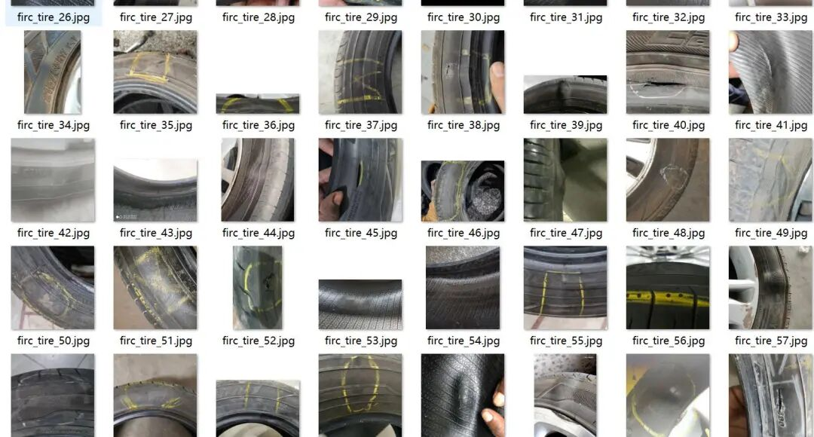
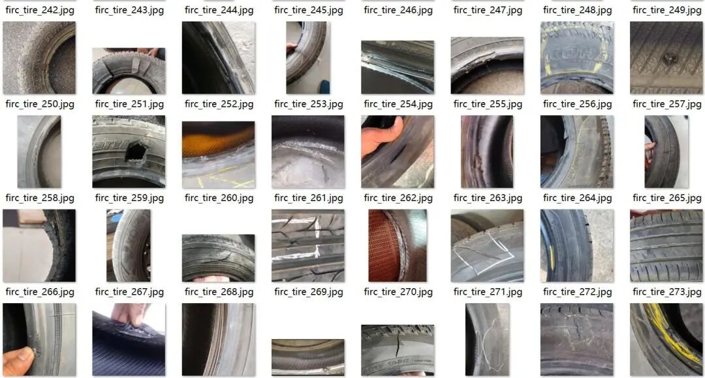
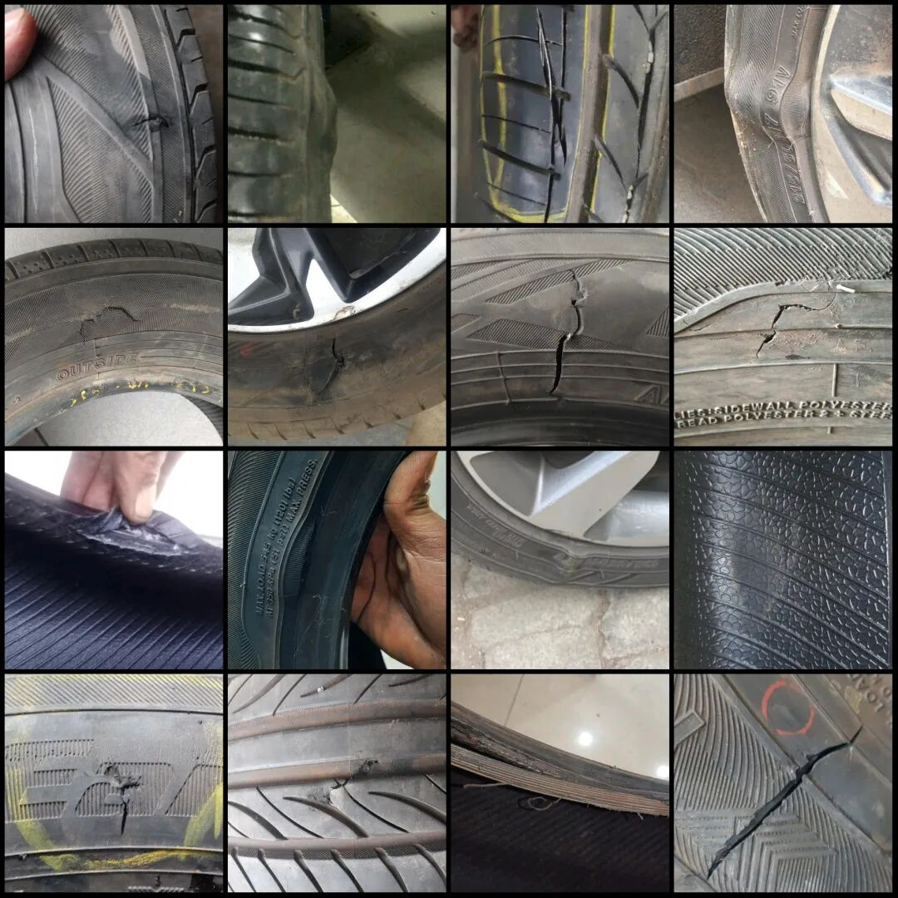
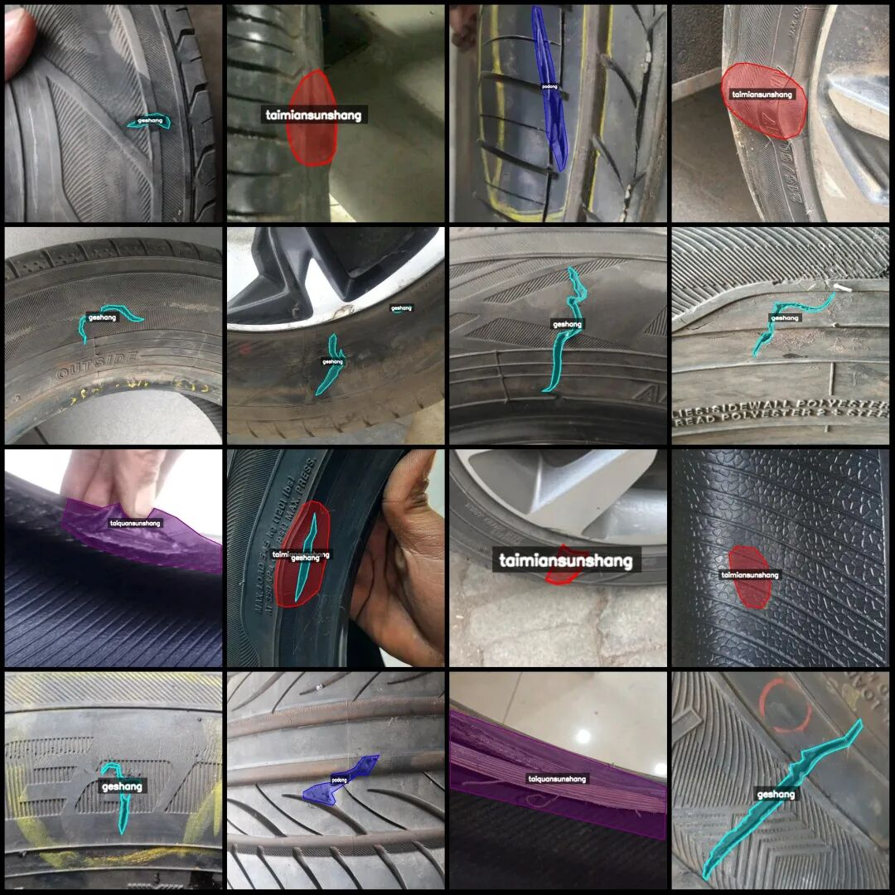
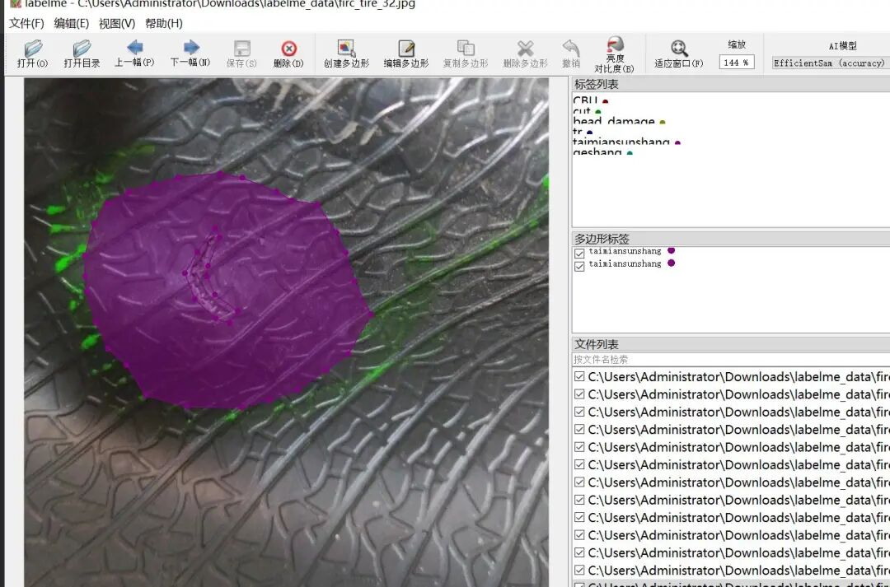

# Tire Surface Defect Identification and Segmentation Dataset in LabelMe format: 879 images, 4 categories

Dataset format: labelme format (without mask files, only including jpg images and corresponding json files)

Number of images (number of jpg files): 879

Number of annotations (number of json files): 879

Labeling category count: 4

Label category names: ["geshang", "podong", "taimiansunshang", "taiquansunshang"]

Number of boxes labeled in each category:

Geshang (cut) count = 379

Podong (hole) count = 188

Taimiansunshang (Tire Surface Injury) count = 289

Taiquansunshang (wrench damage) count = 135

Total frame count: 991

Using labeling tool: labelme=5.5.0

Image resolution: Multi-resolution images, such as 370x528, 453x453, etc.

Annotation rules: Draw polygons around the categories.

Important Notice: The dataset can be opened and edited using LabelMe. For JSON datasets, one must convert them into mask or Yolo formats for semantic segmentation or instance segmentation.

Special : This dataset does not guarantee the accuracy of the trained models or weight files.

Image Preview:

Annotation example:

Original image (pick 16 randomly):

Annotation:

LabelMe editing example:

## Payment

Here is a pay link on Stripe ( https://buy.stripe.com/3cs8yP7sY87d0vu9AB ). Please contact me lonlonago@foxmail.com after funding $89, and I will send you a complete data files , thank you!

